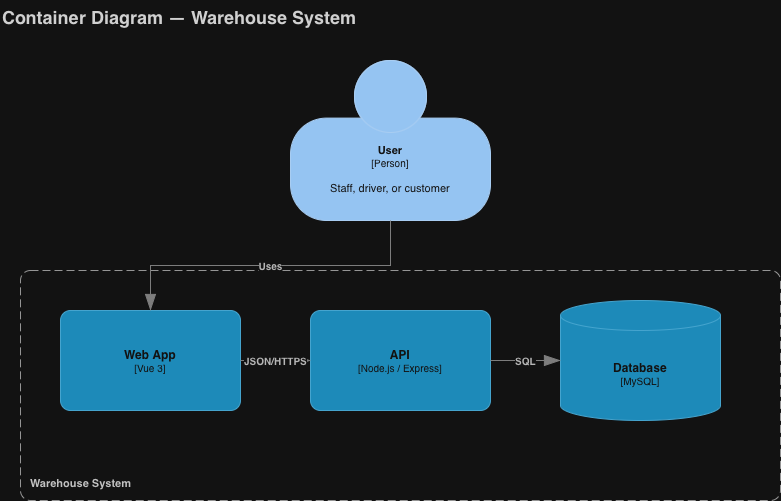
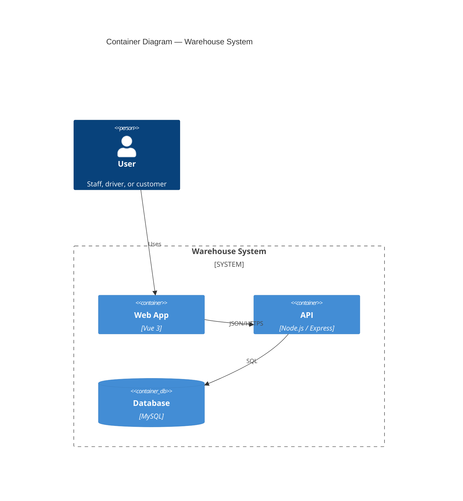

# C4 Level 2 — Containers

The Warehouse System is a web app that calls one API, which stores everything in one database.

Source: [c4-container.drawio](./c4-container.drawio)

## Notes

- The API enforces all security and stock rules ([ADR-0002](../adr/0002-role-based-security.md), [ADR-0008](../adr/0008-inventory-stock-lots-fifo.md)).

**Related:** [ADR-0003](../adr/0003-mysql-relational-database.md) · [ADR-0004](../adr/0004-vue-vuetify-spa.md) · [ADR-0005](../adr/0005-node-express-rest-api.md)
