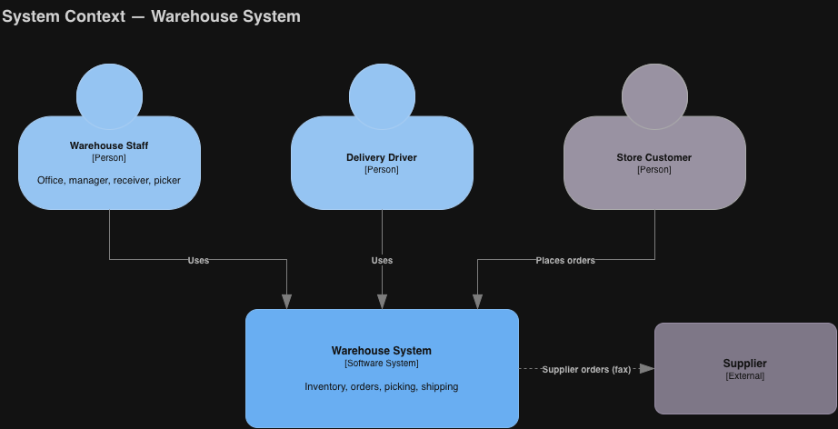
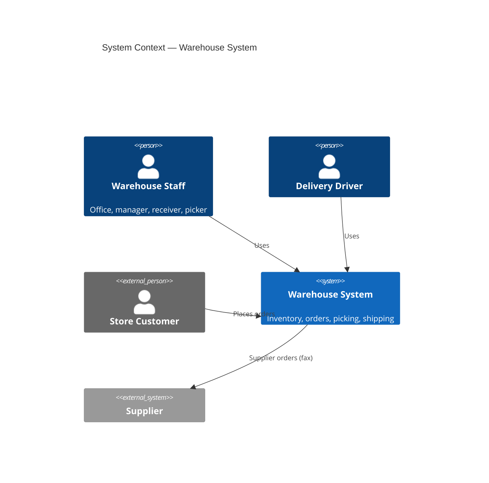

# C4 Level 1 — System context

Who uses the Warehouse System and what sits outside it.

Source: [c4-context.drawio](./c4-context.drawio)

## Notes

- Supplier orders are printed and faxed by the office; there is no automated link to suppliers ([Feature 5](../../features/feature-5-supplier-ordering-receiving.md)).

**Related:** [ADR-0001](../adr/0001-client-server-web-architecture.md) · [c4-container.md](./c4-container.md)
