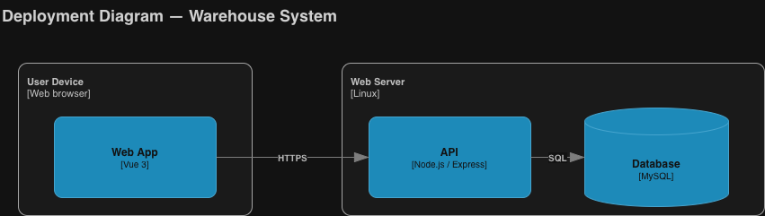
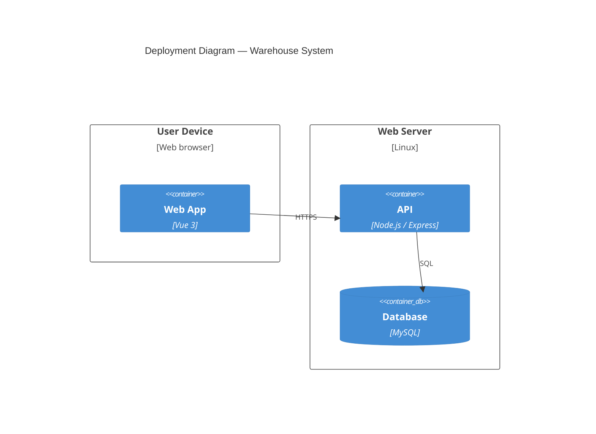

# C4 Deployment

The web app runs in the user's browser; the API and database run on one web server.

Source: [c4-deployment.drawio](./c4-deployment.drawio)

## Notes

- Locally (XAMPP), the user device and web server are the same laptop.

**Related:** [ADR-0001](../adr/0001-client-server-web-architecture.md)
