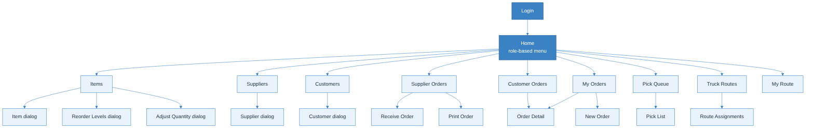
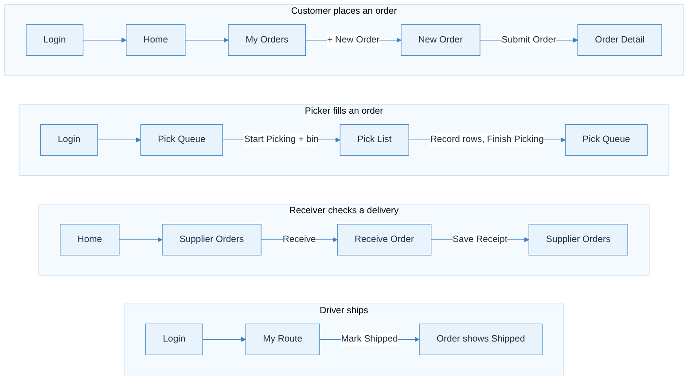

# UI design — Warehouse Management System

Screen mockups for every screen in the feature specs, one sub-folder per feature, plus the screen hierarchy and the main screen flows. The **Screen Requirements** section in each feature spec is the source of truth for labels, buttons, and states; the images show the layout.

---

## 1. Screen hierarchy



```text
Login  (F1)
└── Home: role-based menu cards  (F1)
    ├── Items  (F2)
    │   ├── Item dialog (new/edit)
    │   ├── Reorder Levels dialog        [manager]
    │   └── Adjust Quantity dialog       [manager]
    ├── Suppliers  (F3)
    │   └── Supplier dialog (new/edit)
    ├── Customers  (F4)
    │   └── Customer dialog (new/edit, route select)
    ├── Supplier Orders  (F5)
    │   ├── Receive Order               [receiver, manager]
    │   └── Print Order
    ├── Customer Orders  (F6)           [office, manager]
    │   └── Order Detail
    ├── My Orders  (F6)                 [customer]
    │   ├── New Order (catalog + cart)
    │   └── Order Detail
    ├── Pick Queue  (F6)                [picker, manager]
    │   └── Pick List
    ├── Truck Routes  (F7)              [office, manager]
    │   └── Route Assignments           [manager]
    └── My Route  (F7)                  [driver]
```

### Which cards each role sees on Home

| Role | Cards |
|------|-------|
| Office Worker | Items, Suppliers, Customers, Supplier Orders, Customer Orders, Truck Routes |
| Manager | Items, Suppliers, Customers, Supplier Orders, Customer Orders, Pick Queue, Truck Routes |
| Receiver | Items, Supplier Orders |
| Picker | Items, Pick Queue |
| Driver | My Route |
| Customer | My Orders |

---

## 2. Screen flows



| Flow | Steps |
|------|-------|
| **A. Customer places an order** | Login → Home → My Orders → **+ New Order** → New Order (search, **Add**, one item shows **Out of stock**) → **Submit Order** → Order Detail (status **New**) |
| **B. Picker fills an order** | Login → Home → Pick Queue → **Start Picking** (Bin Number dialog) → Pick List → **Record** each row (one short) → **Finish Picking** → Pick Queue |
| **C. Receiver checks a delivery** | Home → Supplier Orders → **Receive** → Receive Order (8 of 10 cases, "2 cases short", split location) → **Save Receipt** |
| **D. Driver ships** | Login → My Route → **Mark Shipped** → confirm → order shows **Shipped** |
| **E. Manager plans routes** | Home → Truck Routes → **Assignments** → pick date, truck, driver → **Save** |
| **F. Office maintains data** | Home → Items → **+ New Item** → Save; Suppliers → **+ New Supplier**; Customers → **+ New Customer** (assign route) |

---

## 3. Screen inventory and image files

Sizes: **Desktop 1280 × 800** unless noted. Floor screens use **Tablet 1024 × 768**; the driver screen uses **Phone 390 × 844**.

| Feature | Screen | Size | Image | Spec |
|---------|--------|-------|-----------|------|
| F1 | Login | Desktop | `feature-1/login.png` | [Feature 1](../../features/feature-1-user-login.md#screen-requirements) |
| F1 | Home (show the office-worker version) | Desktop | `feature-1/home.png` | 〃 |
| F2 | Items list | Desktop | `feature-2/items.png` | [Feature 2](../../features/feature-2-item-management.md#screen-requirements) |
| F2 | Item dialog | Desktop | `feature-2/item-dialog.png` | 〃 |
| F2 | Reorder Levels dialog | Desktop | `feature-2/reorder-levels-dialog.png` | 〃 |
| F2 | Adjust Quantity dialog | Desktop | `feature-2/adjust-quantity-dialog.png` | 〃 |
| F3 | Suppliers list | Desktop | `feature-3/suppliers.png` | [Feature 3](../../features/feature-3-supplier-management.md#screen-requirements) |
| F3 | Supplier dialog | Desktop | `feature-3/supplier-dialog.png` | 〃 |
| F4 | Customers list | Desktop | `feature-4/customers.png` | [Feature 4](../../features/feature-4-customer-management.md#screen-requirements) |
| F4 | Customer dialog | Desktop | `feature-4/customer-dialog.png` | 〃 |
| F5 | Supplier Orders list | Desktop | `feature-5/supplier-orders.png` | [Feature 5](../../features/feature-5-supplier-ordering-receiving.md#screen-requirements) |
| F5 | Receive Order | Tablet | `feature-5/receive-order.png` | 〃 |
| F5 | Print Order | Desktop (letter page) | `feature-5/print-order.png` | 〃 |
| F6 | My Orders | Desktop | `feature-6/my-orders.png` | [Feature 6](../../features/feature-6-customer-ordering-picking.md#screen-requirements) |
| F6 | New Order | Desktop | `feature-6/new-order.png` | 〃 |
| F6 | Order Detail | Desktop | `feature-6/order-detail.png` | 〃 |
| F6 | Customer Orders | Desktop | `feature-6/customer-orders.png` | 〃 |
| F6 | Pick Queue | Tablet | `feature-6/pick-queue.png` | 〃 |
| F6 | Pick List | Tablet | `feature-6/pick-list.png` | 〃 |
| F7 | Truck Routes | Desktop | `feature-7/truck-routes.png` | [Feature 7](../../features/feature-7-shipping-routes.md#screen-requirements) |
| F7 | Route Assignments | Desktop | `feature-7/route-assignments.png` | 〃 |
| F7 | My Route | Phone | `feature-7/my-route.png` | 〃 |


---

## 4. Visual style

Deliberately plain: one light-blue palette, a system sans-serif font, and the same table, dialog, and chip patterns on every screen.

| Token | Hex | Use |
|-------|-----|-----|
| primary | `#3B82C4` | Top bar, primary buttons |
| primary-dark | `#2A6496` | Headings, table header text |
| light | `#E8F3FC` | Table headers, chips, highlights |
| background | `#F5FAFF` | Page |
| border | `#C9DFF2` | Table lines, inputs, cards |
| text | `#1F2D3D` | Body text |

Status chips: New/Open = light blue, Picking/Partial = amber, Picked = teal, Shipped/Received = green, Cancelled/Closed = grey. Shortages show in amber; out-of-stock and errors in red.

Font: Arial / Helvetica, 14 px body, 22 px page titles. Corners 6–8 px. Spacing on a 4 px grid.

> These colors replace the maroon defaults in `.cursor/rules/ui-style-system.mdc`; update that rule's color table when the app is built.
