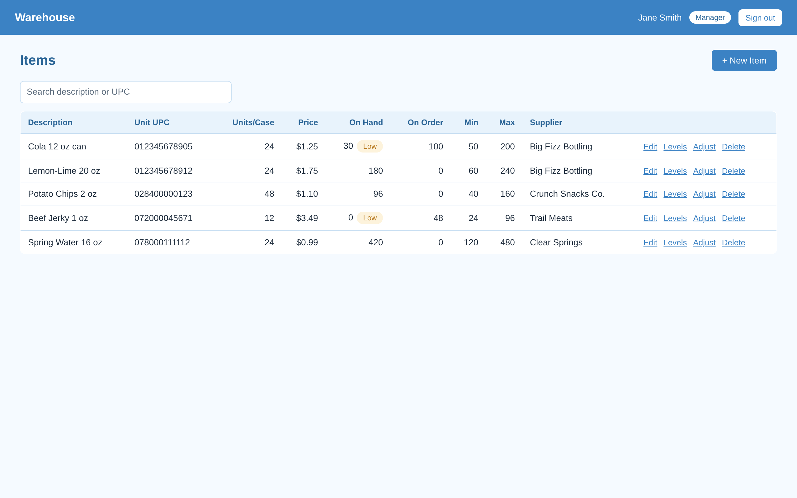
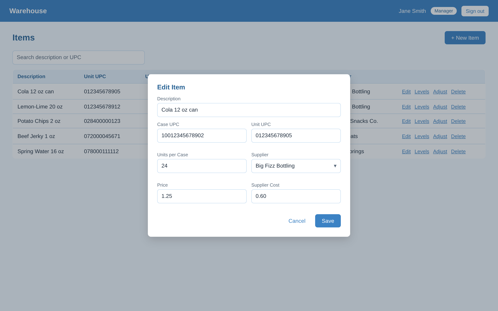
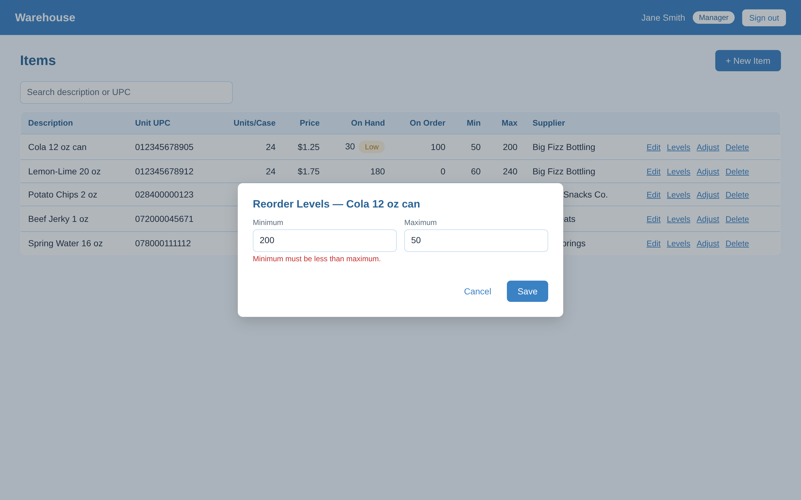
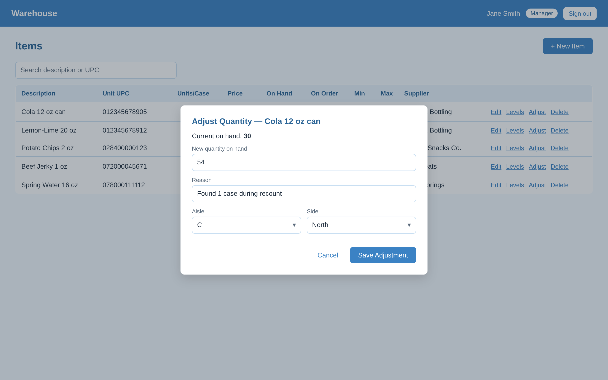

# Feature 2 screens

Exported from Figma (PNG, 2x). Spec: [feature-2-item-management.md](../../../features/feature-2-item-management.md#screen-requirements)

| Screen | Image |
|--------|-------|
| Items list |  |
| Item dialog |  |
| Reorder Levels dialog |  |
| Adjust Quantity dialog |  |
